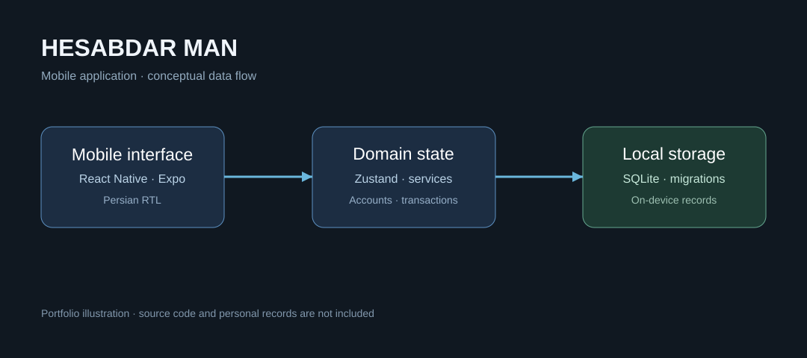

# حسابدار من | Hesabdar Man

**مدیریت مالی شخصی، با تجربه‌ای فارسی و کاربردی.**

**وضعیت پروژه: در حال توسعه و تکمیل.** «حسابدار من» هنوز محصول نهایی یا نسخه آماده انتشار عمومی نیست. بخش‌هایی از امکانات در سورس موجود پیاده‌سازی شده‌اند و برخی بخش‌ها همچنان به توسعه، آزمایش و بهبود نیاز دارند. توضیحات این مخزن نمایی از وضعیت فعلی پروژه‌اند، نه ادعای آماده‌بودن همه قابلیت‌ها.

[English](README.md) · [معماری فنی](docs/ARCHITECTURE.fa.md) · [ملاحظات انتشار](docs/SECURITY.fa.md)

«حسابدار من» اپلیکیشنی برای ثبت و مرور امور مالی روزمره است. حساب‌ها، تراکنش‌ها، بودجه‌ها، گزارش‌ها و فهرست‌های خرید در یک محیط فارسی و راست‌به‌چپ کنار هم قرار گرفته‌اند. اطلاعات مالی اصلی با SQLite روی دستگاه ذخیره می‌شوند.

## بخش‌های محصول

- **حساب‌ها:** تعریف چند حساب، مانده و مرور فعالیت‌های هر حساب.
- **تراکنش‌ها:** ثبت درآمد و هزینه، دسته‌بندی و انتقال بین حساب‌ها.
- **برنامه‌ریزی مالی:** بودجه، خلاصه‌های دوره‌ای و گزارش‌های هزینه.
- **فهرست خرید:** ساخت فهرست، افزودن اقلام و پیگیری پیشرفت.
- **تجربه بومی:** رابط راست‌به‌چپ، تاریخ جلالی و نمایش متناسب با زبان فارسی.
- **ذخیره‌سازی محلی:** ساختار داده و مهاجرت‌های SQLite همراه با Zustand برای مدیریت وضعیت.

این بخش‌ها بر اساس سورس بررسی‌شده معرفی شده‌اند و فرایند تکمیل و بهبود آن‌ها ادامه دارد. **در نسخه بررسی‌شده، زمان‌بندی اعلان‌های یادآوری خرید هنوز عملیاتی نیست.**

## فناوری‌ها

React Native · Expo · JavaScript · SQLite · Zustand · React Navigation · ابزارهای تاریخ جلالی

## معماری فنی

رابط کاربری، مدیریت وضعیت و سرویس‌های داده از هم تفکیک شده‌اند. اطلاعات حوزه‌های مالی در SQLite دستگاه نگهداری می‌شود. [مطالعه معماری فنی](docs/ARCHITECTURE.fa.md)

## وضعیت توسعه

پروژه **در حال تکمیل** است و هنوز نسخه پایدار یا عمومی آن منتشر نشده. ادامه کار شامل بهبود جریان‌های کاربردی، آزمایش مهاجرت دیتابیس و سناریوهای مرزی، تکمیل جزئیات تجربه موبایل و پیاده‌سازی امکانات برنامه‌ریزی‌شده مانند یادآورهاست. تاریخ قطعی برای انتشار نسخه نهایی اعلام نشده است.

## محدوده مخزن

این مخزن صرفاً **ویترین فنی محصول** است، نه سورس قابل نصب اپلیکیشن. کد اصلی، داده‌های مالی، فایل‌های دیتابیس، اطلاعات امضای برنامه و منطق اختصاصی منتشر نشده‌اند. نمودار معماری مفهومی است و اسکرین‌شات واقعی محصول نیست.

## مالکیت

© NaarCode. تمامی حقوق محفوظ است. این مخزن تحت مجوز متن‌باز منتشر نشده است. [حقوق استفاده](RIGHTS.md)

[وب‌سایت NaarCode](https://naarcode.com/fa)
